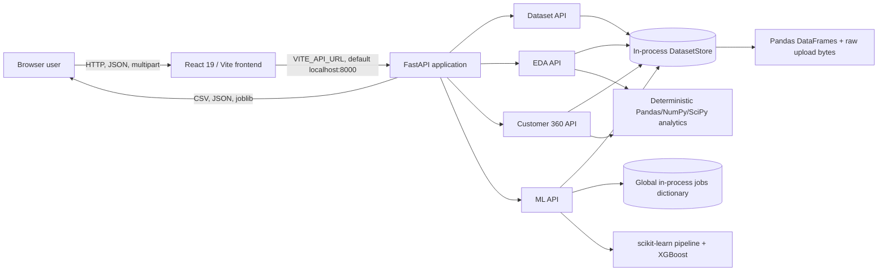
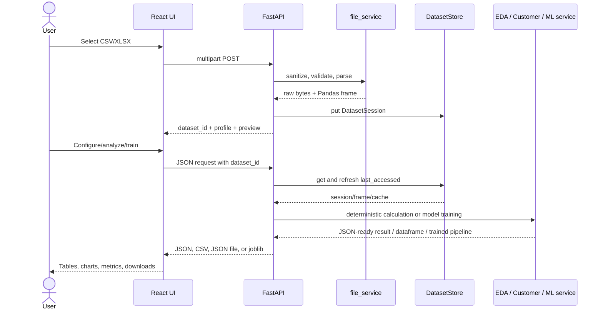

# Project Technical Overview

**Audit date:** 2026-11-23
**Audit scope:** Entire project repository
**Method:** Implementation audit plus production-deployment preparation. Source, configuration, dependency locks, tests, and deployment manifests were treated as authoritative. No VPS, DNS, external service, or live production environment was changed.

> **Operational update (2026-11-24):** The Portfolio is live at `https://ridhotrivo.com`. A least-privilege, digest-based automatic deployment workflow is implemented but remains disabled pending explicit activation. Statements below about deployment not being exercised describe the original 2026-11-23 audit boundary. The `www` hostname still has an authoritative DNS consistency issue and is not part of the CD health gate.

## 1. Executive Summary

This repository is a personal data-science portfolio implemented as a browser application with three working local analytics tools:

1. a preserved XGBoost classification/regression model builder, temporarily disabled by feature flag;
2. a general exploratory data analysis (EDA) workspace; and
3. a Customer 360 workspace for transaction, revenue, RFM, retention, behavior, and customer-level analysis.

The business purpose is demonstrative and analytical rather than transactional: users upload CSV/XLSX data, inspect or map it, invoke calculations in a local FastAPI process, and view/export results. Intended users are portfolio reviewers, analysts, data scientists, and local evaluators with non-confidential datasets. The portfolio home also lists Recommendation System, Demand Forecasting, and Automated Dashboard projects, but these are static claims/cards with no linked implementation in this repository (`src/pages/LegacyPages.jsx`).

The application remains a single-user prototype: a React/Vite single-page frontend calls a FastAPI backend over JSON/multipart HTTP. Uploaded bytes, parsed Pandas frames, Customer 360 mappings, trained models, predictions, and jobs are held only in process memory. There is no database, authentication, durable job queue, external AI service, or cloud integration. Production packaging and deployment automation are now included for a single Ubuntu VPS, but no live deployment is claimed.

Development maturity is best described as a **feature-rich local portfolio prototype**. EDA and Customer 360 are active; XGBoost is preserved but returns HTTP 503 while `ENABLE_XGBOOST=false`. The project now has bounded shared dataset uploads and lightweight in-memory upload throttling, but it remains unsuitable for sensitive or multi-tenant production use because there is no access control, durable state, job ownership, operational telemetry, or multi-process storage coordination.

Overall, the code has sensible separation between APIs, schemas, services, and UI features, explicit upload limits, leakage-aware model preprocessing, formula-safe CSV exports, and deterministic analytics. The largest risks are deployment without isolation, unbounded ML job/model memory, CPU oversubscription, privacy exposure in shared deployments, and correctness gaps around filters, empty datasets, dates, and user-visible controls.

## 2. Technology Stack

Versions below are from `package-lock.json`, `backend/requirements.txt`, or verified local tools. “Rationale” is inferred unless explicitly stated in `README.md`.

| Technology | Verifiable version | Purpose and implementation | Notes / rationale |
|---|---:|---|---|
| React | 19.2.7 | UI composition and state in `src/**/*.jsx` | Component-based dashboards; no router or global state library. |
| React DOM | 19.2.7 | Mounts `App` in `src/main.jsx` | Uses `createRoot` and `StrictMode`. |
| Vite | 8.1.3 | Dev server and production bundling | `package.json`; pathname fallback depends on hosting configuration. |
| `@vitejs/plugin-react` | 6.0.3 | JSX/React transformation | Listed as a runtime dependency; no explicit `vite.config.*` exists, although Vite 8 successfully transformed JSX during audit. |
| Recharts | 3.10.1 | Customer 360 and EDA charts | Used in `CustomerDashboard.jsx` and EDA feature components. |
| FastAPI | 0.116.1 | HTTP API and OpenAPI generation | `backend/app/main.py` and routers under `backend/app/api`. |
| Uvicorn | 0.35.0 | Local ASGI server | Documented local command; no production process manager config. |
| Pydantic | Transitive, not directly pinned | Request validation | Models in `backend/app/schemas`; relying on a transitive dependency weakens reproducibility. |
| Pandas | 3.0.0 | Canonical in-memory dataframes and analytics | Used throughout parsing, EDA, Customer 360, ML, and export. |
| Polars | 1.35.2 | Preferred CSV parsing | Optional import in `file_service.py`, converted immediately to Pandas. |
| NumPy | 2.3.4 | Numeric calculations and histogram/statistical support | ML and analytics services. |
| SciPy | 1.16.3 | Skewness and kurtosis | `advanced_eda_service.py`. |
| scikit-learn | 1.9.0 | preprocessing, split, metrics, tuning, pipelines | `backend/app/ml.py`. |
| XGBoost | 3.3.0 | Classifier/regressor | Local CPU training with histogram tree method. No hosted model provider. |
| OpenPyXL | 3.1.5 | XLSX parsing and worksheet selection | `file_service.py`. |
| xlrd | 2.0.2 | Listed dependency | No code uses it; `.xls` is rejected by the shared file service. |
| Joblib | 1.5.1 | Trusted model serialization; indirectly used by sklearn | `/api/ml/download/{job_id}/model`. |
| python-multipart | 0.0.20 | Multipart uploads | FastAPI upload endpoints. |
| python-dotenv | 1.1.1 | Loads local environment variables | `main.py` and `dataset_store.py`. |
| Pytest / HTTPX | 8.4.1 / 0.28.1 | Unit/service/API tests | `backend/tests`; FastAPI `TestClient`. |
| Python / Node / npm | 3.14.2 / 24.8.0 / 11.6.0 locally | Verified audit runtime | README requires Node 20+ and Python 3.12–3.14. |

No SQL engine, ORM, migration tool, Redis, message broker, container runtime, cloud SDK, LLM SDK, vector database, linter, formatter, type checker, frontend test framework, or observability SDK is configured.

## 3. System Architecture

### High-level architecture



The frontend is a pathname-switched SPA (`src/app/App.jsx`), not React Router. Customer 360 and EDA pages are lazy-loaded; the portfolio and XGBoost page are bundled through `LegacyPages.jsx`. Reusable UI and dataset upload/preview components live under `src/components`; feature-specific components live under `src/features`.

FastAPI is assembled in `backend/app/main.py`. It owns ML endpoints and includes three routers for datasets, EDA, and Customer 360. Pydantic models validate analytics requests. Services contain parsing, profiling, deterministic analytics, and customer logic. XGBoost logic remains in the relatively monolithic `backend/app/ml.py`.

There are two background-thread mechanisms:

- `DatasetStore` starts one daemon sweeper thread to expire inactive sessions.
- every training request starts an unbounded daemon `threading.Thread`; there is no executor, queue, persistence, concurrency limit, or recovery.

Communication is unauthenticated HTTP. CORS allows only `FRONTEND_ORIGIN` plus `http://127.0.0.1:5173`. No external APIs are called. There is no authorization or per-user ownership: possession of a dataset/job ID is sufficient to access it.

## 4. Complete Project Structure

```text
.
├── .env.example                  # Frontend API URL example
├── .gitignore
├── README.md                     # Existing project claims and local instructions
├── index.html                    # Vite HTML entry
├── package.json / package-lock.json
├── dist/                         # Committed/generated frontend build artifacts
├── sample_data/
│   └── customer360_demo.csv
├── src/
│   ├── main.jsx                  # React mount and top-level ErrorBoundary
│   ├── styles.css                # Entire custom/responsive visual system
│   ├── app/App.jsx               # Exact pathname-to-page mapping
│   ├── api/                      # Fetch/XHR clients for datasets, EDA, Customer 360
│   ├── components/
│   │   ├── datasets/             # Shared upload, preview, worksheet workflow
│   │   ├── layout/               # Shared analytics header/footer
│   │   └── ui/                   # Cards, tabs, metrics, loading/error/empty states
│   ├── features/
│   │   ├── customer360/          # Mapping and dashboard views
│   │   └── eda/                  # Eight EDA analysis views
│   └── pages/
│       ├── LegacyPages.jsx       # Portfolio and complete XGBoost UI
│       ├── Customer360Page.jsx
│       ├── EdaPage.jsx
│       └── AnalyticsPlaceholderPage.jsx # Unreferenced milestone placeholder
└── backend/
    ├── .env.example              # Backend variable names/default examples
    ├── requirements.txt          # Fully pinned direct Python packages
    ├── app/
    │   ├── main.py               # FastAPI/ML entry point
    │   ├── ml.py                 # ML detection, validation, training, metrics/export safety
    │   ├── api/                  # Dataset, EDA, Customer 360 routers
    │   ├── schemas/              # Pydantic request models
    │   ├── services/             # Store, parsing, profiling, EDA, customer analytics
    │   └── utils/                # Column inference and JSON serialization
    └── tests/                    # 9 test modules, 22 collected tests
```

`node_modules`, `.venv`, `.venv-old`, Python bytecode, pytest caches, `.DS_Store`, and existing `dist` artifacts are local/generated material, not architecture. No Git metadata was available at the audited root, so commit history and branch status could not be evaluated.

Application entry points are `src/main.jsx` and ASGI object `app` in `backend/app/main.py`. Shared backend state is created at import time in `dataset_store.py` and `main.py`.

## 5. Features and Business Logic

### Portfolio

`PortfolioPage` presents identity, skills, contact, and six project cards. Three cards link to implemented routes. The contact email is the placeholder `hello@example.com`. No content management, contact backend, or analytics exists. **Status: implemented static page; some portfolio claims unverified.**

### Shared dataset workspace

Users choose or drop CSV/XLSX, see XHR upload progress, inspect metadata and first/last/random previews, select XLSX worksheets, paginate first rows, replace, or delete the session (`DatasetWorkspace.jsx`, `datasets.py`). Server validation enforces extension/MIME, non-empty content, 5 MiB, 10,000 data rows, 50 columns, XLSX ZIP signature, and basic CSV binary rejection. Three global sessions are allowed, expire after 15 inactive minutes, and are rejected rather than evicted at capacity. A dependency-free per-client limiter allows 20 upload attempts per 60 seconds by default. Headers are stripped, missing/unnamed headers synthesized, and duplicate headers normalized after parser behavior.

Input is multipart data; output is a generated 32-character hex dataset ID, file metadata, inferred schema, summary, sheets, expiry value, and preview. Errors use FastAPI 4xx responses and friendly frontend messages. **Status: implemented and tested.** Limitations: full raw bytes and a full Pandas copy coexist in memory; MIME/signature checks are not malware scanning; CSV encoding and parser complexity are not bounded by time; expiry displayed is the configured TTL, not remaining time.

### XGBoost model builder

**Current status: temporarily disabled.** `ENABLE_XGBOOST=false` is the backend default and every ML upload, training, status, cancellation, results, prediction, and download endpoint returns HTTP 503. The frontend uses `VITE_ENABLE_XGBOOST=false` to remove navigation, display “Temporarily Unavailable,” and replace the direct project route with a non-interactive notice. All implementation described below remains preserved for reactivation.

Workflow: upload → inspect profile → choose target/features → configure preprocessing/model/tuning → start/poll/cancel job → inspect test metrics/importance/predictions → export or predict another file (`LegacyPages.jsx`, `main.py`, `ml.py`).

Training removes rows with missing targets, optionally drops other missing rows, infers numeric/categorical features, constructs a `ColumnTransformer`, imputes, optionally scales, encodes categories, performs a single train/test split, and fits `XGBClassifier` or `XGBRegressor`. Classification targets use `LabelEncoder`. Optional `GridSearchCV` or `RandomizedSearchCV` runs only on the training partition. Classification returns accuracy, balanced accuracy, precision, recall, F1, MCC, log loss, optional ROC AUC; regression returns R², MAE, MSE, RMSE, median AE, and MAPE. The unseen test frame is retained with predictions.

Progress is stage-level, not estimator-level. Cancellation is checked only when a progress callback runs, so an active `.fit()` cannot be interrupted. Validation checks target/features, class count, numeric regression target, and a minimum of ten usable rows. Errors are saved on the job and shown by polling. **Status: implemented and tested for one binary classification and one regression case.**

Known limitations: request `config` is an unrestricted dictionary; many numeric bounds exist only in HTML; `validation_size` and `date_handling` defaults are never consumed; date columns are treated as categorical unless excluded manually; multiclass, tuning, cancellation, new prediction, export endpoints, pathological class splits, and model serialization are not covered by tests. Jobs/models never expire. The UI accepts `.xls`, but the backend rejects it.

### Exploratory data analysis

After shared upload, `EdaPage` profiles all columns and runs quality checks. Eight tabs provide overview, quality, searchable profiles/type overrides, distributions, correlations/relationships, target analysis, IQR/Z-score outliers, readiness, deterministic insights, and exports.

Type overrides affect calculations only. Numeric distributions use NumPy histograms and SciPy moments; dates aggregate by period; categories show top values. Correlations support Pearson/Spearman with a 40-column cap. Relationships choose scatter, monthly mean line, grouped numeric bar, or 20×20 contingency based on inferred types. Scatter input is capped to the first 5,000 complete records and samples at most 500. Outlier row previews are bounded. Target analysis recommends a problem type and provides class counts or numeric correlations. Readiness is a deterministic rules result, not a model score. Insights are deterministic text templates based on findings/correlations/skew.

Quality rules cover missing/duplicate/constant/near-constant/high-cardinality/identifier-like/mixed/blank/invalid date/invalid number/infinite/extreme/percentage-range conditions. Input/output schemas are in `schemas/eda.py`; user errors are converted to 422. **Status: implemented and tested at service/API smoke level.**

Limitations: no automatic cleaning; type coercion can silently turn invalid values into missing for analyses; relationship grouping is accepted by the API but unused in returned aggregations; the frontend exposes no group selector or date-frequency selector; `time_series_regression` target analysis performs ordinary numeric analysis, not time-series validation; readiness receives but ignores `problem_type`; EDA requests may repeatedly scan the full frame.

### Customer 360

Users upload data, accept/edit semantic column suggestions, and configure Customer ID plus optional transaction/date/revenue/product/demographic roles. Mapping availability gates dashboard tabs. `prepare()` creates internal customer, date, revenue, quantity, and transaction fields. Revenue can be direct or quantity × unit price.

The dashboard provides:

- overview counts, revenue, active/returning customers and date range;
- top customers, Pareto contribution, trends and category/channel/store revenue;
- rank-based quantile RFM scores and deterministic named segments;
- cohort retention and new/returning monthly trends;
- product/category/channel/store/day/hour and basket summaries;
- paginated, searched and sorted customer aggregates;
- customer profiles with regex-based masking/omission of likely name/email/phone columns;
- deterministic findings/recommendations and CSV/JSON exports.

Historical CLV equals summed revenue. Estimated annual CLV extrapolates average transaction value and observed monthly frequency. These are deterministic formulas, not ML predictions. Configuration is cached in the dataset session. **Status: implemented and tested at service/API smoke level.**

Limitations: frontend never allows selecting `mapping.attributes`, despite backend support; recent transactions and revenue trend are returned by profile API but not rendered; dashboard calculates channel/store charts but some are not rendered; there is no sort-direction UI; segment filtering is free text, not discovered values; customer IDs are returned unmasked; masking is name-regex heuristic, not a privacy guarantee. Fully filtered customer, RFM, revenue, retention, and customer-list paths now return explicit empty results and are covered by regression tests.

### Analysis outputs and result interpretation

None of the three analytics workspaces has a single precomputed result. Results are generated from the dataset uploaded during the current backend session. The repository contains a Customer 360 demonstration dataset, but it does not contain persisted reports or trained models. The table below summarizes the result produced by each workspace.

| Workspace | Primary result | Decision supported | Important caveat |
|---|---|---|---|
| Exploratory Data Analysis | Dataset profile, quality findings, distributions, relationships, target diagnostics, outliers, readiness, and calculated insights | Determine whether data is understandable and suitable for analysis or modelling | Findings are advisory and deterministic; the workspace does not automatically clean data or prove causation |
| Customer 360 | Customer/revenue summaries, RFM segments, retention cohorts, behavior metrics, customer profiles, CLV estimates, findings, and recommendations | Understand customer value, engagement, concentration, retention, and behavior | Results depend on correct semantic column mapping; annual CLV is an extrapolation, not a forecast guarantee |
| XGBoost Model Builder | A fitted preprocessing/model pipeline, unseen-test metrics, feature importance, predictions, warnings, and downloadable artifacts | Estimate predictive performance and generate predictions for compatible new data | One train/test split is not proof of production performance; importance is not causal explanation |

#### Exploratory Data Analysis results

The EDA result is assembled across the eight tabs in `src/pages/EdaPage.jsx` and the services behind `backend/app/api/eda.py`.

1. **Overview result.** `profile_dataset()` returns row and column counts, total missing cells, duplicate rows, estimated in-memory bytes, inferred numeric/categorical/date/Boolean/constant counts, and a high-cardinality count. This provides a structural inventory rather than a quality score.
2. **Column profile result.** `detailed_profile()` reports detected/effective/original type, complete and missing counts, uniqueness, examples, most frequent value, and likely-identifier status. Numeric results include minimum, maximum, mean, median, standard deviation, quartiles, and zero/negative percentages. Date results include valid range and invalid-date count. Categorical results include category/rare-category counts and the ten leading values.
3. **Data-quality result.** `analyze_quality()` produces ordered critical, warning, and informational findings. Each finding contains a code, affected column, evidence, count where relevant, and suggested action. Checks cover missing and duplicate data, constant and near-constant columns, identifiers, high cardinality, blank text, mixed values, invalid numeric/date values, infinities, extreme values, and percentage-like columns outside 0–100. The complete/incomplete row totals accompany these findings.
4. **Distribution result.** Numeric columns return histogram buckets plus range, center, spread, quartiles, IQR, skewness, kurtosis, and zero/negative percentages. Categorical/Boolean columns return leading frequencies with an `Other` bucket. Date columns return counts grouped by the requested period and the valid date range.
5. **Relationship result.** Correlation analysis returns the complete Pearson or Spearman matrix and pairs meeting the requested absolute threshold. Two-variable analysis returns a sampled scatter plot for numeric pairs, monthly means for date/numeric pairs, grouped means/medians for category/numeric pairs, or a bounded contingency table for other combinations. Correlation and association do not establish causation.
6. **Target-analysis result.** The system recommends binary classification, multiclass classification, or regression using deterministic type/cardinality rules. Classification results show class frequency and imbalance ratio. Regression results show the target distribution and up to 15 absolute numeric correlations. Selecting `time_series_regression` does not currently perform a genuine temporal split or time-series analysis.
7. **Outlier result.** IQR or Z-score analysis returns lower/upper thresholds, count and percentage for each selected numeric column, the total affected rows, and a bounded sample of source rows. These are potential outliers, not automatically invalid records.
8. **Readiness and insight result.** Readiness is `Ready`, `Ready with warnings`, or `Requires data cleaning`, derived from deterministic missing, duplicate, identifier, constant, shape, class-balance, and quality checks. Insights are text templates derived from quality issues, strong Pearson correlations, and skewed numeric distributions. No LLM generates these statements.
9. **Exports.** Profiles, quality issues, correlation matrices, and outlier rows are downloadable as CSV; readiness and insight summaries are downloadable as JSON. Type overrides affect these calculations but never alter the uploaded frame.

An EDA result should therefore be interpreted as a diagnostic report: it identifies evidence and modelling risks, but leaves cleaning, feature selection, causal interpretation, and final modelling decisions to the user.

#### Customer 360 results

Customer 360 results are calculated only after a mapping is confirmed (`ColumnMapping.jsx`, `customer_analytics_service.py`). Customer ID is required. Date, transaction, revenue, quantity, unit price, product, category, store, channel, registration date, city, gender, and age progressively enable additional results.

1. **Overview result.** Returns included source rows, distinct customers and transactions, summed revenue, average transaction value, average and median customer revenue, new/returning customers, active/inactive customers for the selected activity window, date range, and optional product/category counts. Without a mapped date, active/inactive and date range are unavailable.
2. **Revenue result.** Returns the top 20 customers by historical revenue; revenue contribution from the top 10%, 20%, and 30% of customers; monthly revenue trend when dates exist; and top category, channel, and store totals when mapped. Pareto percentages describe concentration within the filtered historical data.
3. **RFM result.** Recency is days since the latest purchase relative to the dataset reference date, Frequency is distinct mapped transaction count, and Monetary is summed derived revenue. Rank-based quantiles assign scores, with recent activity receiving higher recency scores. Deterministic rules label customers as Champions, Loyal Customers, Potential Loyalists, New Customers, Promising, Cannot Lose Them, At Risk, Lost Customers, Hibernating, or Customers Needing Attention. Results contain segment counts, shares, revenue, and average R/F/M measures plus up to 100 customer rows.
4. **Retention result.** Customers are grouped by first observed purchase month. The matrix reports the percentage of each acquisition cohort active at month 0, month 1, and subsequent observed months. It also returns mean retention by elapsed month and monthly new-versus-returning counts. This is observational cohort retention and can be affected by incomplete history or filtering.
5. **Behavior result.** Returns average basket value, optional items per transaction, optional products per customer, transaction count, leading product/category/channel/store frequencies, purchase weekday, and purchase hour when timestamps carry varying hours.
6. **Customer-table result.** Returns server-calculated customer rows with recency, frequency, monetary value, RFM segment, historical CLV, estimated annual CLV, preferred category/channel/store, favorite product, and optional attributes. Search, sorting, filtering, and pagination are server-side, although the entire aggregate table is recalculated per request.
7. **Customer-profile result.** Returns one customer's aggregate summary, optional mapped attributes, up to 25 recent transactions excluding columns whose names resemble sensitive fields, a monthly revenue trend, and the list of masked/omitted columns. The current UI renders the summary and mapped attributes but not the returned transactions or trend. Masking is heuristic and must not be treated as formal anonymization.
8. **CLV result.** Historical CLV is simply observed summed revenue. Estimated annual CLV is average transaction value multiplied by observed purchase frequency per customer-lifespan month and annualized to 12 months. It is a descriptive extrapolation, not a probabilistic future-value model.
9. **Insight result.** Deterministic findings describe top-20% revenue concentration, At Risk/Cannot Lose Them share and revenue, the leading category, and possible month-one-to-month-two retention decline. Rule-based recommendations may suggest differentiated retention, re-engagement, or onboarding review. No LLM or causal model generates these recommendations.
10. **Exports.** Customer and RFM tables and cohort matrices are CSV; summary and insights are JSON. Customer and RFM exports apply the same dimension, date, segment, minimum-revenue, and minimum-transaction filters used by analytics requests.

Customer 360 output is only as reliable as the input grain and mapping. For example, mapping line-item rows without a stable transaction ID can change frequency and basket calculations; missing history can understate retention and lifespan; refunds/negative revenue have no dedicated treatment.

#### XGBoost Model Builder results

The XGBoost result is produced asynchronously by `train()` in `backend/app/ml.py` and returned through `/api/ml/results/{job_id}` after the job reaches `completed`.

1. **Trained pipeline result.** The retained sklearn `Pipeline` contains train-fitted preprocessing and an `XGBClassifier` or `XGBRegressor`. Numeric features are imputed and optionally scaled; categorical features are imputed and one-hot or ordinal encoded. Classification targets are label-encoded. The fitted pipeline can be downloaded as a trusted-use-only joblib file.
2. **Classification evaluation result.** The API returns accuracy, balanced accuracy, precision, recall, F1, Matthews correlation coefficient, log loss, and ROC AUC for binary classification. Prediction rows include actual target, predicted target, maximum class probability, and correctness. Balanced accuracy/F1/MCC should be considered alongside accuracy for imbalanced targets.
3. **Regression evaluation result.** The API returns R², MAE, MSE, RMSE, median absolute error, and MAPE when non-zero actual targets permit it. Prediction rows include actual target, predicted target, signed error, and absolute error. Metric units and suitability depend on the business target.
4. **Feature-importance result.** XGBoost's transformed-feature importances are sorted descending and the UI shows the leading 15. One-hot features may appear separately. Importance indicates model usage within this fit; it does not show direction, uncertainty, causal effect, or stability across samples.
5. **Model summary result.** Returns problem type, target, training/test row counts, original/transformed feature counts, split percentage, random seed, tuning method, selected parameters, training duration, primary score, and training timestamp. If tuning is enabled, the response also includes the best CV parameters and score.
6. **Warnings and interpretation.** Deterministic warnings flag classes with fewer than four samples and targets where one class exceeds 80%. The textual interpretation states unseen-test accuracy for classification or RMSE for regression. It is not generated by an LLM.
7. **New-data prediction result.** A compatible CSV/XLSX with all required feature columns is passed through the retained pipeline. The API reports row count and unexpected extra columns, retains predictions in the job, and offers a CSV download. Missing features or incompatible values return 422.
8. **Download result.** Users can download unseen-test predictions as CSV, metrics as JSON, the fitted pipeline as joblib, and new-data predictions as CSV. CSV formula prefixes are escaped.

The evaluation uses one unseen test partition; optional tuning uses cross-validation only within the training partition. Results are therefore an estimate for that split, not proof of generalization, fairness, calibration, causal validity, or production stability. The repository contains no persisted trained result: jobs and models disappear on backend restart and otherwise remain in memory without expiry.

## 6. End-to-End Data Flow



For example, a Customer 360 CSV upload is parsed (Polars when available), converted to Pandas, profiled, and stored with its original bytes. Mapping is POSTed and cached. An overview request reconstructs internal columns, applies date/dimension filters, aggregates a customer table, and returns JSON rendered as metric cards. No database operation occurs.

For ML, POST `/api/ml/train` creates a global job record and daemon thread. The thread obtains the dataset, builds a train-only preprocessing/model pipeline, stores the fitted pipeline and results in the job dictionary, while the browser polls status every 800 ms. Downloads serialize retained data on demand.

Data transformations do not mutate the stored uploaded frame except XLSX worksheet changes, which replace the session frame and clear its cache. CSV export cells beginning with `=`, `+`, `-`, or `@` are prefixed with an apostrophe by `protect_csv()`.

## 7. Database Architecture

**No database is implemented.** There are therefore no engines, tables, columns, relationships, primary keys, indexes, constraints, migrations, transactions, backups, or database consistency guarantees.

The storage substitute is `DatasetStore._items: dict[str, DatasetSession]`, protected by an `RLock`. A `DatasetSession` contains metadata, original bytes, a mutable Pandas dataframe, worksheet metadata, timestamps, and a bounded 32-entry analytics-result cache. Keys are random UUID4 hex strings. A daemon sweeper and access-time cleanup remove sessions inactive beyond `DATASET_TTL_SECONDS` (default 900 seconds); capacity defaults to three and rejects new uploads rather than evicting active sessions. Worksheet changes clear all caches and mapping changes invalidate Customer 360 cached results. Restarting the process loses all state. Multiple Uvicorn workers would each have independent state, so requests can fail depending on worker routing.

ML jobs use a separate unprotected global dictionary in `main.py`; job IDs are UUID4 hex strings, but jobs have no TTL/capacity. Dataset deletion does not delete associated completed models/jobs. There is no referential integrity between these stores.

## 8. AI, Machine Learning, and Agent Architecture

The only AI/ML implementation is supervised XGBoost trained locally. There are no LLMs, providers, prompts, agents, tool calls, embeddings, vector stores, RAG, retrieval/reranking, generative decisions, hallucination controls, or model-feedback loop.

The training pipeline is described under Feature Logic. Feature engineering is limited to imputation, optional numeric scaling, and one-hot/ordinal categorical encoding; no explicit date feature extraction exists. Tree importance is reported for transformed features. Split/tuning behavior is leakage-aware in the important sense that preprocessing is inside the sklearn pipeline and fitted within training/CV, while the test set is evaluated once.

Guardrails include dataset size limits, target/feature validation, ID warnings, class imbalance warnings, bounded UI tuning iterations, a server-side 30-iteration cap, maximum five CV folds, and explicit “correlation is not causation”/CLV caveats. However, config values such as estimator count and depth are not server-schema constrained, and parallel CV plus XGBoost `n_jobs=-1` can oversubscribe CPU. Metrics are point estimates only: there are no confidence intervals, baseline comparisons, fairness analysis, drift monitoring, calibration diagnostics, experiment tracking, reproducible dataset hashes, or held-out model registry.

All “insights,” readiness decisions, mapping suggestions, segmentation, and problem-type suggestions are deterministic heuristics/templates, not LLM decisions.

## 9. API and Integration Documentation

All endpoints are unauthenticated. FastAPI/Pydantic provides JSON validation and standard 422 responses. Custom errors commonly use 400, 404, 409, 413, 415, 422, 429, or 503. Uploads have a dependency-free per-client in-memory sliding-window limit, defaulting to 20 attempts per 60 seconds. There is no general request rate limit, API version prefix, retry contract, idempotency key, or external integration.

### Health and datasets

| Method and path | Request | Response / purpose |
|---|---|---|
| `GET /api/health` | — | Status and DatasetStore statistics |
| `POST /api/datasets/upload` | multipart `file` | Shared dataset metadata + 25-row preview |
| `GET /api/datasets/{id}/schema` | — | Cached/recomputed metadata |
| `GET /api/datasets/{id}/preview` | `mode`, `offset`, `limit` query | First/last/random rows, max 100 |
| `POST /api/datasets/{id}/sheet` | `SheetRequest` | Reparse selected XLSX worksheet |
| `DELETE /api/datasets/{id}` | — | Explicit in-memory deletion |

### EDA

`GET /api/eda/{id}/overview`; POST endpoints `/profile`, `/quality`, `/distribution`, `/correlation`, `/relationship`, `/outliers`, `/target-analysis`, `/readiness`, `/insights`, and `/export`. Requests are defined by `backend/app/schemas/eda.py`. Export returns CSV for profiles/quality/correlation/outliers and JSON for summary. All use the existing shared dataset.

### Customer 360

`GET /api/customer-360/{id}/suggestions`; POST `/configure`, `/overview`, `/revenue`, `/rfm`, `/cohorts`, `/behavior`, `/customers`, `/insights`, and `/export`; GET `/customers/{customer_id}`. `configure` must precede analytics. Schemas are in `backend/app/schemas/customer_360.py`.

### ML

| Method and path | Request | Response / purpose |
|---|---|---|
| `POST /api/ml/upload` | multipart `file` | Shared session plus 50-row preview; requires ≥10 rows |
| `POST /api/ml/train` | `TrainRequest` (`dataset_id`, target, features, problem type, free-form config) | Queued `job_id` |
| `GET /api/ml/train/{job_id}/status` | — | State/progress/message/error |
| `POST /api/ml/train/{job_id}/cancel` | — | Cooperative cancellation request |
| `GET /api/ml/results/{job_id}` | — | Metrics, importance, summary, first 100 test predictions |
| `POST /api/ml/predict/{job_id}` | multipart `file` | Retains predictions in job; row count and extra columns |
| `GET /api/ml/download/{job_id}/predictions` | — | Test prediction CSV |
| `GET /api/ml/download/{job_id}/new-predictions` | — | New-data prediction CSV |
| `GET /api/ml/download/{job_id}/metrics` | — | Metrics JSON |
| `GET /api/ml/download/{job_id}/model` | — | Trusted-use-only joblib payload |

Response models are generally implicit dictionaries rather than declared FastAPI response models, reducing schema guarantees and documentation precision.

## 10. Infrastructure and Deployment

Local topology is two processes: Vite on port 5173 and Uvicorn on port 8000. Production topology is Caddy on public ports 80/443, an unprivileged Nginx frontend on an internal network, and one non-root Uvicorn backend worker on that same internal network. Environment variable names include `VITE_API_URL`, `VITE_ENABLE_XGBOOST`, `FRONTEND_ORIGIN`, `ALLOWED_ORIGINS`, `DATASET_TTL_SECONDS`, `MAX_DATASET_SESSIONS`, `UPLOAD_RATE_LIMIT`, `UPLOAD_RATE_WINDOW_SECONDS`, and `ENABLE_XGBOOST`. No secret values were inspected or reproduced.

Production assets include separate multi-stage/non-root frontend and backend images, a resource-bounded Compose stack, private application networking, health checks, rotating Docker logs, and Caddy automatic TLS/security headers. GitHub Actions runs backend tests and the frontend build, then publishes immutable commit-tagged images plus `latest` aliases to GHCR after successful pushes to `main`. Biznet Gio deployment is deliberately disabled: there is no deployment job, SSH access, or public endpoint verification in the workflow. Metrics, tracing, alerting, application-state backup, Kubernetes, and Terraform remain absent.

Horizontal scaling is incompatible with in-memory sessions/jobs without sticky routing and still would not share state. Multiple worker processes would split datasets from jobs. A static host must route all portfolio paths to `index.html`; this rewrite configuration is absent. CORS is exact-origin restricted but defaults to local development.

## 11. Testing and Quality

Backend tests combine unit/service and in-process API integration tests:

- dataset parsing/store/API validation;
- EDA profiles, quality, advanced calculations, API/export smoke paths;
- Customer 360 mapping, calculations, API workflow, privacy masking/export;
- basic ML detection, validation, binary classification, and regression.

On 2026-11-23, `PYTHONDONTWRITEBYTECODE=1 .venv/bin/python -m pytest -q -p no:cacheprovider` run from `backend/` produced **30 passed in 3.02s**, with **70 deprecation warnings** from FastAPI/joblib use of an asyncio API deprecated for Python 3.16. Running pytest from the repository root previously produced nine collection errors (`ModuleNotFoundError: app`), consistent with the documented script changing into `backend` first. The production build, directed to a temporary directory, succeeded with Vite 8.1.3 (621 modules transformed in 0.673 seconds).

There is no measured line/branch coverage configuration, frontend unit/component/E2E/accessibility/visual testing, API contract test, concurrency/load test, security scan, lint/type check, or CI enforcement. Important missing backend cases include malformed/large XLSX, multiclass and tuning, cancellation/concurrency, all download/predict paths, empty filtered customer results, negative revenue, time zones, duplicated IDs, high-cardinality memory, filter correctness in exports, and multi-worker behavior.

Quality concerns include dense one-line JSX/Python in key files, duplicated column detection/serialization logic in `ml.py` versus utilities, a large global CSS file, implicit response schemas, free-form ML configuration, no frontend router, and committed generated artifacts/environment directories in the working copy (some are ignored but present).

## 12. Security and Reliability

Positive controls include extension/MIME/size/shape checks, filename sanitization, XLSX/CSV content checks, strict CORS origins, Pydantic request validation, generic parsing errors, no uploaded spreadsheet formula execution, CSV formula protection, privacy caveats, regex-based profile masking, and a warning about untrusted joblib files.

Primary risks:

- **No authentication, authorization, or tenancy.** Anyone who can reach the API can upload, consume CPU/memory, and use known IDs. IDs are high entropy but are bearer capabilities, not authorization.
- **Data privacy.** Full uploads and raw bytes remain in server memory; most analytics responses/exports can contain customer IDs or original data. Regex masking is incomplete and only affects selected profile paths.
- **Resource exhaustion.** Active dataset count, dataset shape, file size, cache entries, and upload attempt rate are bounded. If XGBoost is re-enabled, its training threads/jobs remain unbounded, trained pipelines persist forever, and nested `n_jobs=-1` parallelism can exhaust a host.
- **Reliability.** No retries, request/fit timeouts, graceful job persistence, worker coordination, circuit breakers, readiness probe, or structured telemetry. Cancellation is not immediate.
- **Input trust.** File checks are useful but are not antivirus, decompression-bomb protection, formula inspection for input, or robust content-type verification. Serialized model downloads are unsafe if later loaded by untrusted parties; the UI warning is appropriate.
- **Error handling.** Training saves `str(exception)` in the client-visible job. Most analytics convert expected `ValueError`; unexpected exceptions can become generic FastAPI 500s. Frontend fetches have no timeout/abort, but primary EDA profiling and Customer 360 dashboard requests now ignore stale responses.

SQL injection and prompt injection do not apply because there is no SQL or LLM. Spreadsheet/CSV formula injection is specifically mitigated on generated CSVs. There is no secrets-management system; the only variables currently documented are non-secret configuration values.

## 13. Performance and Scalability

No benchmark or load-test results exist; the only measured timings in this audit are the 8.52-second test suite and 0.576-second frontend build, neither representing production performance.

Potential bottlenecks are whole-file upload/read, simultaneous raw-bytes + Polars/Pandas copies, `frame.duplicated()`, high-cardinality `value_counts()`, full correlations (capped at 40 columns), Customer 360 customer-table construction, and synchronous Pandas handlers. Repeated identical EDA and Customer 360 requests now use a bounded per-session LRU-style cache. The 5 MiB compressed XLSX limit still does not strictly bound expanded workbook memory. If re-enabled, XGBoost/CV CPU use and retained models/results remain important risks.

Caching is limited to base dataset profile and mappings in `DatasetSession.cache`; advanced EDA and customer aggregates are recomputed. Browser bundles include approximately 408 KB and 431 KB uncompressed chunks according to the verified build; Recharts/shared dependencies dominate. EDA and Customer 360 routes are lazy-loaded, which partially mitigates initial load.

The design is suitable for small, trusted, single-process local use. Scaling requires persistent/object storage, a shared metadata store, bounded external workers, job/session ownership, quotas, cache strategy, and preferably columnar/lazy processing rather than repeated Pandas copies.

## 14. Development Status and Technical Debt

| Component | Current status | Evidence | Known issue | Severity | Recommended improvement |
|---|---|---|---|---|---|
| Portfolio | Implemented static | `LegacyPages.jsx` | Placeholder email; three unlinked claims | Low | Replace placeholders and distinguish demos from prose claims |
| Shared uploads | Implemented/tested | `file_service.py`, dataset tests | Memory duplication; no malware/decompression controls | High | Stream/object-store uploads and scan in deployed environments |
| Dataset lifecycle | Implemented local only | `dataset_store.py` | Per-process and LRU eviction; no ownership | High | Shared durable store with tenant/session scope |
| XGBoost training | Implemented/tested basic paths | `ml.py`, `test_ml.py` | Unbounded threads/config/jobs; dates ignored | Critical for public deployment | Typed config, queue, quotas, TTL, date policy |
| ML cancellation | Partial | `run_job()` progress callback | Cannot interrupt active fit | Medium | Worker cancellation/termination semantics |
| EDA | Broadly implemented/tested | EDA services/tests | Repeated synchronous scans; several controls not surfaced | Medium | Cache results and complete UI/API alignment |
| Customer 360 | Broadly implemented/tested | customer service/tests | Filtered exports incorrect; heuristic privacy | High | Apply filters consistently and formalize privacy rules |
| API contracts | Partial | Pydantic requests | Mostly no response models/versioning | Medium | Add versioned response schemas |
| Authentication | Not implemented | No auth dependency/middleware | Public access unsafe | Critical | Add identity, ownership, authorization |
| Database/storage | Not implemented | In-memory dicts only | Restart/data loss and no multi-worker support | High | Add persistent metadata/object/model storage |
| Deployment/operations | Container publishing only | Dockerfiles, Compose, Caddy, GitHub Actions, GHCR, Biznet Gio runbook | Automated VPS deployment disabled; no live monitoring | Medium–High | Complete a separate deployment review before enabling VPS automation |
| Frontend tests | Not implemented | No test dependencies/files | Regressions/accessibility unverified | Medium | Add component and browser E2E tests |
| Backend tests | Implemented baseline | 22 passing tests | Narrow edge/concurrency coverage | Medium | Coverage gates and adversarial cases |

## 15. Gaps Between Documentation and Implementation

| Existing claim or implication | Implementation evidence | Assessment |
|---|---|---|
| XGBoost accepts CSV, XLSX, and XLS | Both ML and shared upload call `create_session()` where `ALLOWED_SUFFIXES={".csv", ".xlsx"}` | **Incorrect. XLS is rejected (415); `xlrd` is unused.** |
| XGBoost uses first Excel sheet | True for XLSX through `create_session`; XGBoost UI cannot switch sheet | Accurate but constrained. |
| Shared dataset expiry/deletion | Store sweeper and DELETE endpoint exist | Accurate; displayed expiry is configured TTL rather than exact remaining TTL. |
| “validation” controls | `validation_size` exists in frontend defaults only | **Misleading/unused. There is train/test and CV during tuning, no separate validation split.** |
| Date handling configuration | `date_handling: 'exclude'` exists only in defaults | **Unused. Date-like features can be categorical.** |
| Customer attributes can be mapped | Backend schema/service supports `attributes`; UI always sends `[]` | **Partially implemented/inaccessible from UI.** |
| Customer exports respect filters | Customer/RFM CSV paths now apply transaction-level and aggregate filters; regression tests verify minimum-revenue filtering | **Implemented and verified.** |
| Customer profile contains transactions/trend | API returns them | Implemented but undocumented in UI because not rendered. |
| Revenue by channel/store and behavior channel/store/hour | Backend returns these arrays | Implemented but not rendered by current dashboard. |
| “Server-side” customer pagination/filtering | Customer aggregation/filter/slice occurs in backend | Accurate, though every request recomputes the full table. |
| Production guidance | README and Biznet Gio runbook describe the implemented container/CI path | Configuration exists and is locally validated; provisioning and live deployment remain manual. |
| Recommendation, forecasting, automated dashboard projects | Only static cards exist | Claims cannot be verified from this repository. |
| `AnalyticsPlaceholderPage` milestone flow | No route imports it | Dead/unreferenced code. |
| `ChartContainer` | No usages found | Unused shared component. |
| `analyze`, duplicate `detect_kind`/`json_value` in `ml.py` | ML upload uses shared profiling metadata; tests call `analyze` | Partly legacy/duplicated logic. |

README is generally strong about local-only state and production exclusions, but its feature inventory should be regenerated from implementation and explicitly separate backend-returned data from UI-visible behavior.

## 16. Recommendations and Roadmap

| Priority | Problem and evidence | Impact | Proposed solution | Complexity |
|---|---|---|---|---|
| P0 | No auth/ownership (`main.py` and routers have no security dependencies) | Dataset/model disclosure and abuse on any reachable deployment | Add authentication, tenant/user ownership on every session/job, authorization checks, secure cookies/tokens, and deployment deny-by-default | High |
| P0 | Unbounded training threads/jobs/models; free-form config; nested full-CPU parallelism | Host denial of service and memory exhaustion | Typed bounded `TrainConfig`; job/session quotas and TTL; fixed worker pool/external queue; CPU/memory/time limits; single controlled parallelism layer | High |
| Completed | Customer/RFM exports previously ignored supplied filters (`customer_export`) | Incorrect business output was possible | Filters are now applied and covered by API regression tests | Completed |
| P1 | In-memory, per-process state | Data loss, no multi-worker scaling, routing failures | Persist metadata, datasets, models, and job state; use object storage plus database/queue | High |
| P1 | XLS claim/UI conflicts with backend | Predictable user failure | Either implement secure `.xls` parsing end-to-end or remove `.xls` UI/docs and unused `xlrd` | Low–Medium |
| P1 | Privacy masking is heuristic and narrow | PII leakage in tables/exports/profile IDs | Explicit sensitive-column classification, configurable policies, least-data responses, audit logs, deletion guarantees | High |
| P1 | No timeout, decompression-bomb/malware controls | Availability/security exposure | Add parse/training timeouts, workbook expansion limits, isolated scanning, and deployment request limits | Medium–High |
| P1 | Empty/edge customer paths need broader coverage | Core fully-filtered results now return empty responses, but unusual dates/revenue remain lightly tested | Add adversarial date, refund, and malformed-grain cases | Medium |
| P2 | Unused controls and incomplete UI/API exposure | Misleading UX | Remove or implement `validation_size`/`date_handling`; surface attributes, group/date frequency, returned charts/profile details | Medium |
| P2 | Repeated full-frame computation | Slow interactive use | Cache by dataset revision + normalized request; invalidate on sheet change; profile hotspots | Medium |
| P2 | Response contracts and error taxonomy are implicit | Client drift and weak API docs | Add response models, API versioning, stable machine-readable errors | Medium |
| P2 | No frontend/E2E/quality automation | UI regressions and weak release confidence | Add Vitest/Testing Library, Playwright, lint/type checks, coverage and CI | Medium |
| P2 | Python 3.14 deprecation warnings | Future Python 3.16 compatibility risk | Track FastAPI/joblib dependency updates and test supported interpreter matrix | Low |
| P3 | Dense legacy files/duplicate helpers | Maintenance cost | Split `LegacyPages.jsx`/`ml.py`, consolidate type/serialization helpers, remove dead components | Medium |
| P3 | No model governance/advanced evaluation | Limited analytical rigor | Baselines, confidence intervals, calibration/fairness, experiment metadata, drift monitoring | High |

## 17. How to Run and Maintain This Project

The following local flow is verified by configuration and, where noted, audit execution.

Prerequisites: Node 20+ and Python 3.12–3.14. The audited environment used Node 24.8.0 and Python 3.14.2.

```bash
# Frontend, repository root
npm install
npm run dev

# Backend, separate terminal
cd backend
python -m venv .venv
source .venv/bin/activate
pip install -r requirements.txt
uvicorn app.main:app --reload
```

Dependency installation was **not** executed during this audit. Start URLs are `http://localhost:5173/` and API health at `http://localhost:8000/api/health`. Copy `.env.example`/`backend/.env.example` only when overriding defaults; do not commit real environment files.

Verified checks:

```bash
npm run build
npm run test:backend
```

The equivalent backend command must run from `backend`; root-level direct pytest fails to import `app`. The audit build used a temporary output directory to avoid modifying repository artifacts. For troubleshooting, verify both processes, check `/api/health`, hard-refresh, and re-upload after any backend restart. Dataset IDs and mappings are invalidated on restart/expiry; jobs also disappear on restart.

A documented deployment procedure now exists in `DEPLOYMENT_BIZNET_GIO.md`, with same-origin production API routing, SPA rewrites, automatic TLS, explicit CORS origins, health checks, and resource limits. It has not been exercised against a live VPS. Authentication and tenant ownership remain P0 requirements before hosting sensitive or multi-user workloads; the prepared deployment should be treated as a public portfolio demo using non-confidential uploads. Do not treat `uvicorn --reload` as a production command.

Maintenance should keep Node and Python lock/pin files current together, run backend tests and frontend builds, inspect deprecation warnings, add regression tests for every analytics formula change, and document formula/version changes because RFM/CLV/cohort outputs are business definitions rather than universal truths.

## 18. Evidence and Verification Summary

### Inspected

- all repository-owned source files under `src/` and `backend/app/`;
- all nine backend test modules;
- `README.md`, `DEPLOYMENT_BIZNET_GIO.md`, Dockerfiles, Compose/Caddy/Nginx configuration, `.github/workflows/ci.yml`, environment examples, and `.gitignore`;
- `package.json`, `package-lock.json`, `backend/requirements.txt`, `index.html`;
- repository file/directory inventory, generated artifact presence, sample-data presence;
- endpoint decorators, environment/config usages, unused configuration markers, and dependency versions;
- pytest cache metadata only as part of inventory; no cached outcome was treated as current evidence.

`src/styles.css` was inventoried and its role/size assessed; individual style rules were not semantically audited because they do not alter data/business logic. Existing compiled `dist` JavaScript was not reverse-engineered because current source and a fresh temporary build were available. Dependency source inside `node_modules`/`.venv` was not audited.

### Commands/checks performed

- file inventory via `find`, `rg --files`, `wc`, and targeted `sed` reads;
- endpoint/config/dead-marker searches via `rg`;
- locked frontend version extraction from `package-lock.json`;
- local runtime version checks;
- backend pytest from repository root (failed collection due to import path, documented above);
- backend pytest from `backend/` with bytecode/cache writes disabled (30 passed, 70 warnings);
- Vite production build (succeeded, 621 modules transformed);
- Docker Compose production configuration rendering (succeeded).

### Not performed

No packages were installed, no server was exposed, no browser E2E session was run, no real user dataset was uploaded, no live deployment was performed, and no load/security/malware/static-analysis scan was run. Container execution and Caddy runtime validation depend on Docker-daemon access and are recorded separately in the handoff. The audit did not validate visual fidelity or every statistical result against an independent oracle. No secrets or live `.env` values were read.

### Assumptions and unresolved questions

- The intended operating model is trusted local use, inferred from defaults and README; a public hosting plan is unknown.
- Required privacy/compliance regimes, expected concurrency, dataset sensitivity, target latency, and acceptable model-governance level are unspecified.
- Static portfolio claims outside linked applications cannot be verified from this repository.
- The reason generated `dist`, environments, and caches are present without Git metadata is unknown.

### Confidence

Confidence is **high** for architecture, implemented endpoints, storage model, dependency versions, test/build status, and the presence and static validity of deployment configuration. Confidence is **medium-high** for runtime edge-case and scalability findings because they are implementation-based but were not load-tested. Confidence is **low/unknown** for live production behavior, security posture on the target VPS, and business correctness on real datasets because no deployment or domain acceptance test was performed.
