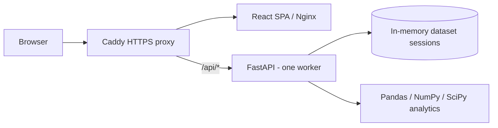

# Ridho Trivonanda — Data Portfolio

A personal Data Science and Data Engineering portfolio built with React and FastAPI. It presents selected work and includes two interactive, server-backed analytics applications for exploring tabular and customer transaction data.

> Production deployment configuration is included, but this repository does not claim that a live production deployment currently exists.

## Project overview

The portfolio demonstrates practical data work across profiling, quality analysis, customer analytics, segmentation, retention, and machine-learning workflows. Uploaded files are processed by the FastAPI service and retained only in bounded, expiring process memory.



## Features and status

| Feature | Status | Description |
|---|---|---|
| Personal portfolio | Available | Profile, categorized skills, and selected project summaries |
| Exploratory Data Analysis | Available | Schema profiling, quality findings, distributions, correlations, relationships, targets, outliers, readiness, insights, and exports |
| Customer 360 Analytics | Available | Flexible column mapping, revenue analysis, RFM segmentation, cohort retention, behavior, customer views, CLV descriptions, insights, and exports |
| XGBoost Model Builder | Temporarily unavailable | Implementation is preserved, but frontend access and all ML endpoints are disabled by default |
| Indonesia Wildfire Intelligence — LLM & RAG | In development | Portfolio project description only; its application implementation is not contained in this repository |

EDA insights and Customer 360 recommendations are deterministic calculations and templates, not external AI API output. No uploaded dataset is sent to an LLM provider.

## Technology stack

- **Frontend:** React 19, Vite 8, Recharts, CSS
- **Backend:** Python 3.12–3.14, FastAPI, Uvicorn, Pydantic
- **Data and ML:** Pandas, Polars, NumPy, SciPy, scikit-learn, XGBoost
- **Files:** CSV, XLSX, OpenPyXL
- **Testing:** Pytest, HTTPX/FastAPI TestClient
- **Infrastructure:** Docker, Docker Compose, unprivileged Nginx, Caddy, GitLab CI/CD

Dependency versions are pinned in `backend/requirements.txt` and locked in `package-lock.json`.

## Project structure

```text
.
├── src/                         # React application, pages, features, API clients, styles
├── backend/
│   ├── app/                     # FastAPI entry point, routers, schemas, services, ML code
│   ├── tests/                   # Backend unit and API tests
│   ├── Dockerfile               # One-worker, non-root FastAPI image
│   ├── requirements.txt         # Development and test dependencies
│   └── requirements.production.txt # Runtime dependencies with disabled ML excluded
├── deploy/
│   ├── Caddyfile                # HTTPS reverse proxy and security headers
│   ├── Caddyfile.local          # HTTP-only local integration proxy
│   └── nginx.conf               # Static SPA server and route fallback
├── scripts/docker_integration_test.sh # End-to-end local container checks
├── sample_data/                 # Anonymized Customer 360 demonstration CSV
├── Dockerfile.frontend          # Multi-stage Vite/Nginx image
├── docker-compose.prod.yml      # Production frontend/backend/Caddy stack
├── .gitlab-ci.yml               # Test, build, deploy, and verify pipeline
├── .env.production.example      # Production configuration template
├── DEPLOYMENT_BIZNET_GIO.md     # Complete VPS deployment runbook
└── PROJECT_TECHNICAL_OVERVIEW.md
```

Application entry points are `src/main.jsx` and `backend/app/main.py` (`app.main:app`).

## Prerequisites

For local development:

- Node.js 20 or newer
- npm (the lockfile is version 3)
- Python 3.12–3.14

For container deployment:

- Docker Engine 27 or a compatible supported release
- Docker Compose v2
- A public domain whose DNS resolves to the VPS
- Public TCP ports 80 and 443; UDP 443 is optional but enabled for HTTP/3

## Local development

### Backend

```bash
cd backend
python -m venv .venv
source .venv/bin/activate
pip install -r requirements.txt
cp .env.example .env
uvicorn app.main:app --reload
```

The API is available at `http://localhost:8000`; health status is at `http://localhost:8000/api/health`.

### Frontend

In a second terminal:

```bash
npm ci
cp .env.example .env
npm run dev
```

Open `http://localhost:5173`. The local frontend uses `VITE_API_URL=http://localhost:8000`.

Local variables:

| Variable | Default/example | Purpose |
|---|---|---|
| `VITE_API_URL` | `http://localhost:8000` | Browser API origin in development |
| `VITE_ENABLE_XGBOOST` | `false` | Frontend ML feature flag |
| `FRONTEND_ORIGIN` / `ALLOWED_ORIGINS` | `http://localhost:5173` | Exact FastAPI CORS origins; `ALLOWED_ORIGINS` supports comma-separated values |
| `DATASET_TTL_SECONDS` | `900` | Inactivity expiration |
| `MAX_DATASET_SESSIONS` | `3` | Global process-local session capacity |
| `UPLOAD_RATE_LIMIT` | `20` | Upload attempts per window and client address |
| `UPLOAD_RATE_WINDOW_SECONDS` | `60` | Upload rate-limit window |
| `ENABLE_XGBOOST` | `false` | Backend ML feature flag |

## Production containers

Build images locally when needed:

```bash
docker build -f Dockerfile.frontend -t ridho-portfolio-frontend:local .
docker build -f backend/Dockerfile -t ridho-portfolio-backend:local backend
```

For an actual domain, copy and edit the production template, set image references to available local or registry tags, then start the stack:

```bash
cp .env.production.example .env.production
docker compose --env-file .env.production -f docker-compose.prod.yml config
docker compose --env-file .env.production -f docker-compose.prod.yml pull
docker compose --env-file .env.production -f docker-compose.prod.yml up -d --no-build
```

Operational commands:

```bash
docker compose --env-file .env.production -f docker-compose.prod.yml ps
docker compose --env-file .env.production -f docker-compose.prod.yml logs -f --tail=200
docker compose --env-file .env.production -f docker-compose.prod.yml restart
docker compose --env-file .env.production -f docker-compose.prod.yml down
```

Only Caddy publishes ports 80 and 443. Frontend and backend communicate on a private Docker network. Caddy obtains and renews HTTPS certificates automatically after DNS and firewall configuration are correct.

See [DEPLOYMENT_BIZNET_GIO.md](DEPLOYMENT_BIZNET_GIO.md) for server preparation, CI/CD variables, first deployment, rollback, monitoring, and troubleshooting.

## GitLab CI/CD

`.gitlab-ci.yml` defines four stages:

1. **Test:** run backend Pytest and a frontend production build.
2. **Build:** build frontend/backend images, tag them with `CI_COMMIT_SHA`, and push to the GitLab Container Registry.
3. **Deploy:** only a protected default branch can update production through SSH. Compose pulls the exact SHA tags.
4. **Verify:** retry the public frontend and `/api/health`; fail the pipeline if either remains unavailable.

Tests run for all pipelines. Image build jobs run for branch pipelines. Production deploy/verify jobs require the protected default branch plus protected GitLab variables. A commit to `main` triggers deployment only after those prerequisites are configured.

## Testing and validation

```bash
# Backend
cd backend
.venv/bin/python -m pytest -q

# Frontend
cd ..
npm run build

# Production configuration
docker compose --env-file .env.production.example -f docker-compose.prod.yml config
docker build -f Dockerfile.frontend -t ridho-portfolio-frontend:check .
docker build -f backend/Dockerfile -t ridho-portfolio-backend:check backend
```

Container builds require a running Docker daemon and network access to base images and package registries.

For the repeatable HTTP-only local integration stack, tag the images as `:integration`, then run:

```bash
docker compose -f docker-compose.local-test.yml up -d --wait
./scripts/docker_integration_test.sh
docker compose -f docker-compose.local-test.yml down
```

The local stack publishes only `127.0.0.1:8088`; it does not request certificates or require DNS.

## Application limitations

- Uploads support CSV/XLSX up to 5 MB, 10,000 data rows, and 50 columns.
- At most three dataset sessions exist per backend process; inactivity expiry defaults to 15 minutes.
- Uploaded bytes, dataframes, mappings, caches, and jobs are held in memory and are lost on restart or container replacement.
- The backend must run with one worker. Multiple replicas would not share sessions.
- Upload throttling is process-local and keyed by the address observed by FastAPI; it is not a distributed abuse-prevention system.
- Authentication, user accounts, durable storage, malware scanning, and backups of uploaded datasets are not implemented. Do not upload confidential data.
- XGBoost remains disabled in production. Its training dependencies are intentionally excluded from the runtime image and retained in the development/test dependency set.
- Caddy rejects request bodies larger than 6 MB before they reach FastAPI; parsed datasets remain limited to 5 MB, 10,000 rows, and 50 columns.
- Caddy state is persisted for certificate continuity; application datasets are intentionally not persisted.

## Author

**Ridho Trivonanda**

Data Scientist & Data Engineer

[ridho.trivonanda@gmail.com](mailto:ridho.trivonanda@gmail.com)

[GitHub repository](https://github.com/ridhotr27/data-science-portfolio)
